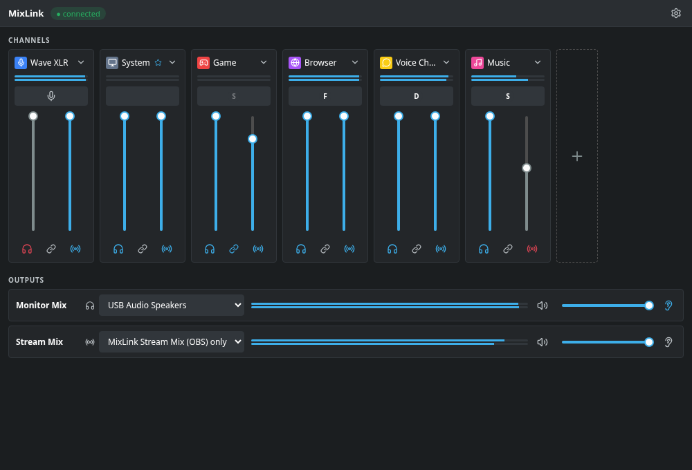

# MixLink

A Wave Link–style audio mixer for Linux/PipeWire.



MixLink is an independent open-source project, not affiliated with or endorsed by
Elgato or Corsair. "Wave Link" and "Wave XLR" are trademarks of their respective
owners; the screenshot above uses mock data.

## Features

- Virtual channels (Game, Browser, Voice Chat, Music, System, ...) that each show up
  as a separate audio device in PipeWire and OBS.
- Per-channel **monitor** and **stream** faders with independent mute, a link button
  to move both together, and persistent app routing — assign an app to a channel by
  drag & drop or a picker, and it moves there again on every restart.
- **Monitor Mix**: the mix you hear yourself, on any output device you choose.
- **Stream Mix**: a virtual source (`MixLink Stream Mix`) for OBS and similar tools,
  with an optional additional hardware output (e.g. a second pair of speakers or an
  HDMI output) so you can monitor exactly what viewers hear.
- Listen switch to flip your own monitor output between the Monitor Mix and the
  Stream Mix.
- Tray icon with autostart, for desktops that support `StatusNotifierItem` (e.g. KDE
  Plasma).
- A scriptable CLI (`mixlink`) for hotkeys and automation.
- A real-time mixer implemented as a PipeWire filter node in Rust — no extra audio
  hop, no clicking when you move a fader.

## How it works

The daemon `mixlinkd` owns the PipeWire graph. Each channel is a virtual sink;
applications get routed to one of these sinks by rule. A custom real-time mixer node
sums all channels into two outputs: the Monitor Mix (linked to your chosen playback
device) and the Stream Mix (a virtual source for OBS, optionally also linked to a
hardware device). The GUI and CLI never touch audio directly — they talk to
`mixlinkd` over a Unix socket and the daemon does the routing.

```
 Discord ─┐
 Spotify ─┼──▶ [virtual channel sinks] ──▶ [mixlink.mixer] ──▶ Monitor output device
 Firefox ─┘                                 (real-time DSP) ──▶ MixLink Stream Mix ──▶ OBS
                                                             └─▶ optional hardware output
```

`mixlink-gui` (Tauri 2 + Svelte 5) and `mixlink` (CLI) are both thin clients of the
daemon; either one can be closed without affecting your audio.

## Requirements

- PipeWire ≥ 1.0 with WirePlumber. Tested on PipeWire 1.6.9 / WirePlumber 0.5.18 /
  KDE Plasma 6 (Wayland); other PipeWire-based desktops should work but are untested.
- To build from source:
  - Rust ≥ 1.85 (edition 2024) and `cargo`
  - `clang` (for the PipeWire FFI bindings)
  - PipeWire development headers
  - WebKitGTK 4.1 and GTK 3 development packages (Tauri's Linux webview)
  - Node.js and `pnpm` (to build the GUI frontend)

Best-effort package names (check your distro's exact names if a build fails):

| Distro | Packages |
|---|---|
| Arch Linux | `base-devel clang pipewire webkit2gtk-4.1 gtk3` |
| Debian/Ubuntu | `build-essential clang libpipewire-0.3-dev libwebkit2gtk-4.1-dev libgtk-3-dev` |
| Fedora | `@development-tools clang pipewire-devel webkit2gtk4.1-devel gtk3-devel` |

## Installation

```bash
git clone <repo-url> mixlink
cd mixlink
scripts/install.sh
```

Stop Sonusmix or any other PipeWire routing tool first — MixLink expects to own
routing for the apps you assign to its channels.

`scripts/install.sh` builds everything in release mode and installs under
`~/.local` (no `sudo`, no system packages):

- `~/.local/bin/{mixlinkd,mixlink,mixlink-gui}`
- the systemd user unit `~/.config/systemd/user/mixlinkd.service`
- the application menu entry `~/.local/share/applications/dev.mixlink.gui.desktop`
- icons under `~/.local/share/icons/hicolor/*/apps/mixlink.*`
- it then enables and (re)starts the `mixlinkd` user service

The first time `mixlink-gui` runs, it enables its own autostart entry
(`~/.config/autostart/mixlink-gui.desktop`) so it comes back in the tray after login.

## Usage

### GUI

Launch `mixlink-gui` from the application menu or your terminal. Each channel strip
has:

- two vertical faders — left for the Monitor Mix, right for the Stream Mix
- a link button to move both faders together, and separate mute buttons per mix
- an app field: drag an app icon onto another channel strip to move it there, or
  click the field to open a picker of currently running apps

At the bottom, **Outputs** has one row per mix, each with a master volume/mute and
an ear icon — exactly one of the two is active at a time, and it picks which mix
plays on your Monitor Mix output device:

- **Monitor Mix** — pick the physical output device you listen on
- **Stream Mix** — the device dropdown's first entry is "MixLink Stream Mix (OBS)
  only" (the default); picking a device additionally routes the Stream Mix to that
  hardware output, so you can monitor exactly what's being streamed

Closing the window sends MixLink to the tray; audio keeps running. "Quit" in the
tray menu closes the GUI only — `mixlinkd` and your mix keep running as a service.

### CLI

```bash
mixlink status                         # channels, mixes, running apps
mixlink volume music stream -10        # relative change
mixlink volume game monitor 60         # absolute level (0-100)
mixlink mute voice both                # toggle; on/off also work
mixlink assign discord "voice chat"    # permanently assign an app to a channel
mixlink unassign discord
mixlink listen stream                  # hear the Stream Mix on your monitor output
mixlink output                         # list playback devices (M/S mark the
                                        # current monitor/stream output)
mixlink output "USB Audio Speakers"    # set the Monitor Mix output device
mixlink output --stream hdmi           # also route the Stream Mix to this device
mixlink output --stream none           # ...back to OBS only (default)
mixlink mix monitor 80                 # Monitor Mix master volume (0-100, +N, -N)
mixlink mix stream mute                # Stream Mix master mute (unmute/toggle too)
mixlink --json status                  # machine-readable output for any command
```

Channel, app and device names are matched case-insensitively, by prefix, substring
or (as a last resort) fuzzy similarity, so `mixlink volume musik 50` still finds
"Music". An ambiguous or unknown name fails with the list of valid options.

### OBS setup

Add an **Audio Input Capture** source and pick the device **MixLink Stream Mix** —
that's the Stream Mix described above. To capture a single channel's audio
separately, add an **Audio Output Capture** source and pick e.g. **MixLink Game**.

## Configuration & files

| What | Where |
|---|---|
| Config | `~/.config/mixlink/config.toml` (created on first run, written automatically) |
| Socket | `$XDG_RUNTIME_DIR/mixlink.sock` |
| Logs | `journalctl --user -u mixlinkd -f` |

Both paths respect overrides: `MIXLINK_CONFIG` / `MIXLINK_SOCKET` env vars, and
`XDG_CONFIG_HOME` for the config directory. Log verbosity follows `RUST_LOG`
(`RUST_LOG=debug systemctl --user restart mixlinkd` or run `mixlinkd` directly).

Example config:

```toml
version = 1
fallback_channel = "system"   # unassigned apps play here
listen = "monitor"

[mixes.monitor]
output_device = "alsa_output.usb-Elgato_Systems_Elgato_Wave_XLR_0000000000-00.analog-stereo"
volume = 100
muted = false

[mixes.stream]
volume = 80
muted = false
# output_device = "..."       # optional extra hardware output, unset = OBS only

[[channels]]
id = "voice-chat"
name = "Voice Chat"
icon = "chat"
color = "#facc15"
monitor = { volume = 100, muted = false }
stream  = { volume = 60, muted = true }
apps = ["discord", "slack"]
```

## Troubleshooting

- **GUI shows "MixLink service is not running"** — `mixlinkd` isn't running; click
  "Start service" or run `systemctl --user start mixlinkd`. Check
  `journalctl --user -u mixlinkd -e` for why it failed.
- **Blank/empty GUI window** — a WebKitGTK/GPU driver issue; run
  `WEBKIT_DISABLE_DMABUF_RENDERER=1 mixlink-gui`.
- **No tray icon** — the tray needs a `StatusNotifierItem` host (KDE Plasma has one
  built in). On desktops without one (e.g. plain GNOME), the window just closes
  instead of hiding to the tray when the tray host isn't reachable.
- **Apps don't move to their assigned channel** — some apps (notably browsers) only
  expose one audio stream for all tabs/windows, so only the whole app can be moved,
  not individual tabs. Restarting the app after assigning it also helps.
- **Audio sounds routed by something else** — stop other routing tools (Sonusmix,
  `pavucontrol`-based scripts, etc.) before starting MixLink; two tools fighting over
  the same streams will not behave well together.

## Uninstall

```bash
scripts/uninstall.sh            # keeps your config
scripts/uninstall.sh --purge    # also removes the config (see below)
```

Stops and disables the `mixlinkd` service, stops a running `mixlink-gui`, and removes
everything `scripts/install.sh` put under `~/.local` and the autostart entry.
With `--purge`, it also removes `$MIXLINK_CONFIG` if that's set to a non-empty value,
or otherwise `~/.config/mixlink` (`$XDG_CONFIG_HOME/mixlink` if `XDG_CONFIG_HOME` is set) —
the same precedence `mixlinkd`/`mixlink` use to find the config file.

## Development

Workspace layout:

```
crates/core/      mixlink-core  — shared domain types, protocol, name resolution
crates/daemon/     mixlinkd      — the daemon: PipeWire graph, mixer, IPC, config
crates/cli/        mixlink       — command-line client
crates/desktop/    mixlink-desktop — Tauri-free desktop glue (autostart, icons)
gui/, gui/src-tauri/  mixlink-gui — Tauri 2 + Svelte 5 GUI
packaging/         systemd unit, .desktop entry
```

```bash
cargo test --workspace                                 # no audio hardware needed
cargo test -p mixlinkd -- --ignored --test-threads=1    # against real PipeWire
```

The `--ignored` tests create and tear down real PipeWire nodes; stop your running
`systemctl --user stop mixlinkd` first so it doesn't fight over the same devices.

GUI development (run from `gui/`):

```bash
pnpm install
pnpm dev:mock     # Svelte app in the browser against a simulated daemon
pnpm test         # Vitest unit tests
pnpm check        # svelte-check
pnpm build        # production frontend build
pnpm screenshot   # Playwright screenshots of the mock UI, into gui/screenshots/
pnpm tauri dev    # the real Tauri app against a running mixlinkd
```

Design docs live in `docs/superpowers/specs/` (architecture) and
`docs/superpowers/plans/` (per-milestone implementation plans).

## Roadmap

- Mic effects chain (noise suppression, gate, compressor, EQ) and Wave XLR hardware
  controls (gain, mic mute, headphone volume, card profile).
- An MCP server so LLM agents can control the mixer (`mixlink mcp`).

## License

MIT — see [LICENSE](LICENSE).
